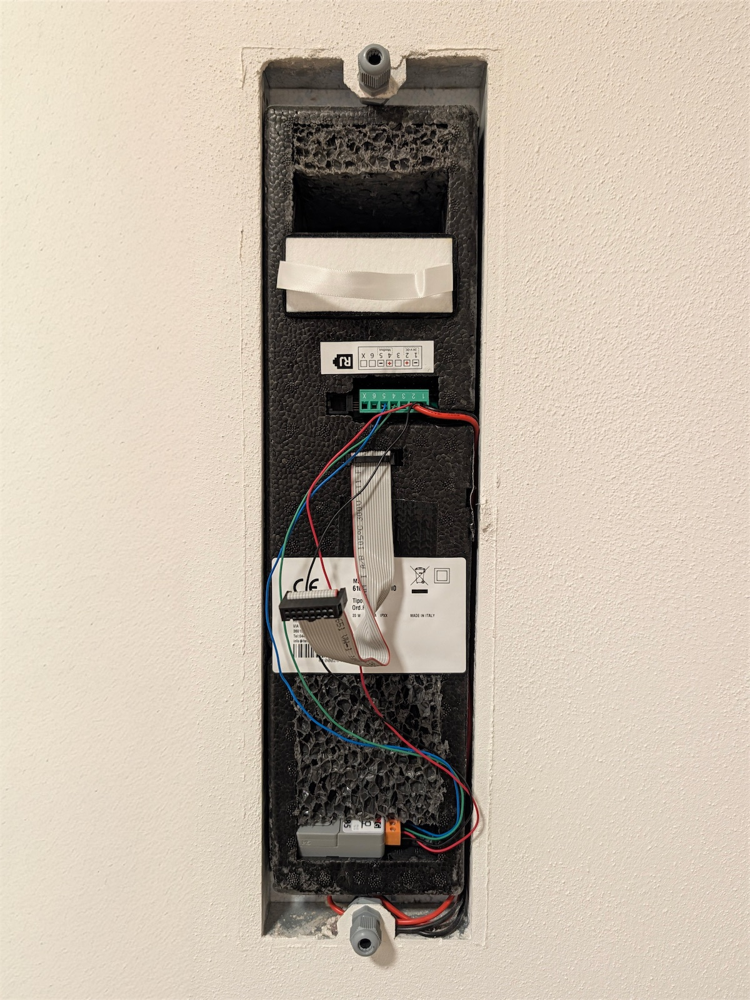
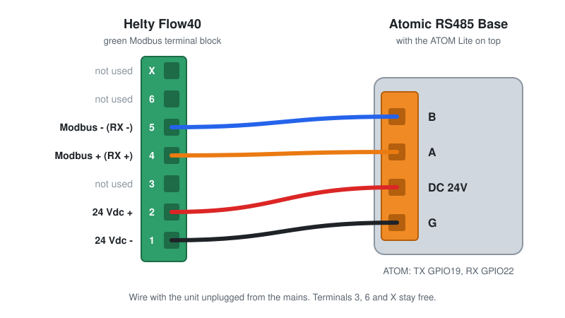
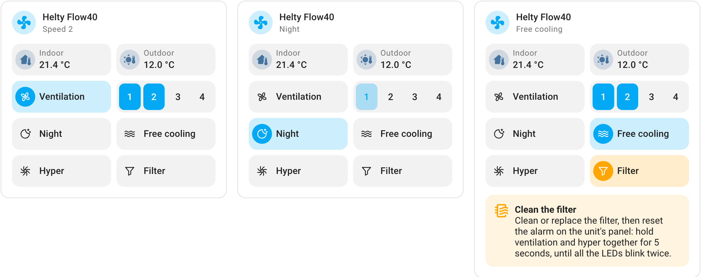

<p align="center">
  
</p>

<p align="center">
  <strong>Control a Helty Flow40 ventilation unit from Home Assistant<br>
  using two snap-together modules and four wires.</strong>
</p>

<p align="center">
  <a href="https://esphome.io/"></a>
  <a href="https://www.home-assistant.io/"></a>
  <a href="#dashboard-card"></a>
  <a href="LICENSE"></a>
</p>

The **Helty Flow40** is a single-room heat recovery ventilation unit (known in
Italy as a *VMC*). Units equipped with the Modbus terminal block can be monitored
and controlled over RS-485: this project connects an **M5Stack ATOM Lite**
running [ESPHome](https://esphome.io) to that bus and brings the unit into
Home Assistant, with no cloud and no vendor app.

It is designed to be simple and inexpensive to build:

- **No soldering** - Two off-the-shelf modules that snap together, four
  wires into screw terminals, and one configuration file to paste. No
  custom PCB or 3D printing required.
- **Affordable** - Around €30-40 in total, shipping included (see the
  [shopping list](#shopping-list)).
- **No external power supply** - Powered directly by the unit's 24 V rail
  and compact enough to fit inside the casing.
- **100% Local** - Everything stays on your local network.
- **Safe by design** - The firmware only modifies the operating mode and
  never writes to any register on boot.
- **Familiar UI** - Includes a custom [dashboard card](#dashboard-card) modeled
  after the unit's wall panel, designed to blend seamlessly with core Home Assistant cards.

<p align="center">
  
</p>

---

## What you get

| Entity | Type | Description |
|---|---|---|
| Ventilation | Fan | On/off, 4 fan speeds, plus *Hyper*, *Night*, and *Free cooling* presets |
| Hyper, Night, Free cooling | Switches | Activate a preset. Presets are mutually exclusive; turning one off restores the previous fan speed |
| Indoor and outdoor temperature | Sensors | In °C, with 0.1 °C resolution |
| Filter alarm, frost alarm, indoor/outdoor fan fault | Binary sensors | Read directly from the unit's alarm register |
| Modbus communication | Diagnostic | Reports *Connected* if the unit has responded within the last 35 seconds |
| Alarm code, firmware version, Wi-Fi signal, sensor faults, EEPROM error | Diagnostic | For system status and troubleshooting |

State updates every 10 seconds, including when changes are made directly
from the unit's physical controls or remote.


## Requirements

- A **Helty Flow40 with the Modbus terminal block**: the green 7-pin
  terminal block (`1`-`6` and `X`) next to the RJ socket, providing 24 Vdc on
  terminals `1`-`2` and Modbus on terminals `4`-`5`.
- **Home Assistant** with the **ESPHome Device Builder** add-on,
  version **2026.9.0** or later.
- **2.4 GHz Wi-Fi** coverage where the unit is installed.
- A computer with **Chrome** or **Edge** for the initial USB flash.
- A small flathead screwdriver. A multimeter is recommended to verify the 24 V polarity before connecting.

> [!IMPORTANT]
> If your unit does not have the green terminal block with Modbus on terminals 4 and 5,
> this project is not compatible: the ESP will have nothing to communicate with.

## Shopping list

Both modules are available from the **M5Stack Official Store** on AliExpress.
Prices are checked on AliExpress Italy as of November 2026 (VAT included) and may vary
with frequent store discounts.

| Part | SKU | Where to buy | Price |
|---|---|---|---|
| **M5Stack ATOM Lite** (ESP32) | C008 | [AliExpress](https://www.aliexpress.com/item/1005008476946567.html) | €17-19 |
| **M5Stack Atomic RS485 Base** | A131 | [AliExpress](https://www.aliexpress.com/item/1005005912210853.html) | €10-12 |
| 4-conductor cable | - | Any electrical supply store: alarm cable (2×0.50 + 2×0.22 mm²) or a short piece of UTP network cable (use a twisted pair for A and B) | €1-5 |
| USB-C **data** cable | - | Needed only for the initial flash | €0-5 |
| Shipping | - | Free standard shipping from the M5Stack Official Store (10-20 days) | €0 |
| **Total** | | | **~€30-40** |

Optional: a **USB-to-RS485 adapter** (€5-15) to communicate with the unit from a
computer using [HeltyShell](https://github.com/fabioscarparo/HeltyShell), useful for discovering the Modbus
address or testing without the ESP.

> [!NOTE]
> Make sure to buy the **ATOM Lite** (C008). While the base physically fits other Atom boards,
> this configuration is written and tested specifically for the ATOM Lite (the AtomS3
> Lite requires a different board definition and pinout). The older **ATOM RS485
> Kit** (K045) that bundled both parts is discontinued; purchase the two modules
> separately.

## Installation

### 1. Prepare ESPHome

1. In Home Assistant, open **ESPHome Device Builder** and verify that you are running
   version 2026.9.0 or later.
2. Select **Secrets** (top right) and add the entries from
   [`esphome/secrets.yaml.example`](esphome/secrets.yaml.example).
   If `wifi_ssid` and `wifi_password` are already defined, just add
   `helty_api_key` and `helty_ap_password`. You can generate the API key with:

   ```bash
   openssl rand -base64 32
   ```

   Keep this key handy: Home Assistant will ask for it in Step 5.
3. Select **+ New device**, name it `helty-flow40`, choose **ESP32**, and
   skip the initial installation step.
4. Click **Edit** on the newly created device, replace the entire content with
   [`esphome/device.yaml`](esphome/device.yaml), and save.

`device.yaml` is a minimal wrapper that pulls the full configuration
([`esphome/helty-flow40.yaml`](esphome/helty-flow40.yaml)) directly from
this repository. At the top of the file, you can customize:

| Setting | Default | Description |
|---|---|---|
| `device_name` | `helty-flow40` | Network hostname |
| `friendly_name` | `Helty Flow40` | Device name in Home Assistant and prefix for all entity IDs |
| `modbus_address` | `2` | Unit's Modbus address (`2` by default from the factory) |

To localize entity names into another language, see
[Language support](#language-support).

> [!TIP]
> Prefer a standalone configuration? Paste the full contents of
> [`esphome/helty-flow40.yaml`](esphome/helty-flow40.yaml) instead
> of `device.yaml`. It works identically, though you will need to apply future updates manually.

### 2. First flash over USB

Perform the initial flash via USB with the **ATOM Lite unplugged from the RS485 base**.

1. In ESPHome Device Builder, select **Install → Manual download** and choose
   **Factory format**. The first compile takes a few minutes and downloads a `.bin` file.
2. Connect the standalone ATOM Lite to your computer using a USB-C data cable.
3. Open [web.esphome.io](https://web.esphome.io) in Chrome or Edge, click
   **Connect**, select the ATOM's serial port, then click **Install** and
   select the downloaded `.bin` file.
4. Once flashed, the ATOM reboots and connects to Wi-Fi: its status in ESPHome Device Builder will change to **Online**.

*(If you access Home Assistant over HTTPS, you can select **Install → Plug into this computer** to compile and flash in a single step.)*

At this stage, the logs will show Modbus timeouts: this is normal since the unit is not wired yet. All future updates will happen OTA via Wi-Fi.

### 3. Wiring

> [!WARNING]
> Disconnect the ventilation unit from mains power before opening the cover and wiring.

<p align="center">
  
</p>

| Flow40 terminal | Signal | Atomic RS485 Base |
|---|---|---|
| 1 | 24 Vdc - (GND) | **G** |
| 2 | 24 Vdc + | **DC 24V** |
| 4 | Modbus + | **A** |
| 5 | Modbus - | **B** |
| 3, 6, X | Not used | - |

1. Strip 6-7 mm of insulation from each wire and secure them into the unit's screw terminals and the base's orange terminal block. The pin labels (`B`, `A`, `DC 24V`, `G`) are printed on the base.
2. **Optional check:** Before plugging the orange connector into the RS485 base, briefly power on the unit and use a multimeter to verify that you read approximately **+24 Vdc** between terminal 2 (`+`) and terminal 1 (`-`). Power the unit back off before proceeding: reverse polarity can damage the base.
3. Snap the ATOM Lite onto the RS485 base and secure it using the included M2 screw.

**Important notes:**

- **Don't connect USB while the base is powered by the unit**: to be safe, avoid feeding the same 5 V rail from two supplies. Use Wi-Fi for updates once installed.
- **No termination resistor needed**: with a single device and a short cable run, the RS-485 bus works reliably without termination.
- **Single master on the bus**: unplug the ESP before connecting another Modbus master or HeltyShell.

### 4. First power-up

1. Restore power to the Flow40: the base powers the ATOM Lite, which connects to Wi-Fi within a few seconds.
2. Open the device **Logs** in ESPHome Device Builder: Modbus timeouts should now be replaced by valid register reads.
3. If you still see only timeouts after a minute, swap the wires on terminals 4 and 5 (or `A` and `B` on the base) and try again. For further diagnostics, see [Troubleshooting](docs/troubleshooting.md).

### 5. Add to Home Assistant

1. Go to **Settings → Devices & services**: Home Assistant should automatically discover **Helty Flow40**. Click **Configure**.
2. When prompted for the encryption key, paste your `helty_api_key`.
3. Verify that **Modbus communication** shows **Connected** and that the temperature readings look accurate.
4. Test the controls: turn on **Ventilation**, change speeds, or toggle **Night** mode. The unit will respond within a few seconds.

### 6. Dashboard and automations

Install the [Helty Flow40 card](#dashboard-card) for a dashboard interface modeled after the unit's wall panel. Alternatively, [docs/home-assistant.md](docs/home-assistant.md) provides a layout built purely with stock Home Assistant cards, along with ready-to-use automations (scheduled night mode, filter maintenance reminders, automatic summer free cooling, and offline alerts).

## Dashboard card

<picture>
  <source media="(prefers-color-scheme: dark)" srcset="images/card-dark.png">
  
</picture>

The **Helty Flow40 card** mirrors the physical wall panel of the unit, using the same icons and layout, plus direct speed buttons next to the ventilation button. Built to match Home Assistant's native tile cards, it automatically adapts to light/dark themes and your profile's language.

| Control | Action |
|---|---|
| Header icon | Toggles the unit on and off (like a standard tile card) |
| Header title | Opens the fan entity's more-info and history dialog |
| Indoor, Outdoor | Displays temperatures; tap either to view its history graph |
| Ventilation | Cycles like the physical button: Off → 1 → 2 → 3 → 4 → Off |
| 1 2 3 4 | Shows the active speed (lit up like the panel LEDs); tap any number to jump directly to that speed |
| Night | Activates quiet minimum speed; tap again to return to the previous speed |
| Hyper | Activates maximum airflow (all four speed indicators lit); tap again to return to the previous speed |
| Free cooling | Toggles free cooling mode on or off |
| Filter | Highlights in amber when the filter needs cleaning, with the reset steps in the banner below |

The card also displays clear banners if Modbus communication is lost, or if a frost alarm or hardware fault occurs.

> [!IMPORTANT]
> The card requires version **1.0.0** or later of the ESPHome configuration, as it auto-discovers the device by its model attribute and maps entities by their default icons. If you flashed an earlier version, update your device via **Install → Wirelessly**.

### Install via HACS

Because the card is not in the default HACS store yet, add this repository as a custom repository:

1. Open **HACS**, then click **⋮ → Custom repositories**.
2. Paste `https://github.com/fabioscarparo/helty-home-assistant` and select the **Dashboard** category.
3. Find **Helty Flow40 Card**, open it, and click **Download**. HACS automatically registers the dashboard resource and notifies you of future updates.
4. Refresh your browser.

### Manual installation

1. Copy [`helty-flow40-card.js`](helty-flow40-card.js) into your Home Assistant `config/www/` directory.
2. Go to **Settings → Dashboards → ⋮ → Resources → Add resource**, enter `/local/helty-flow40-card.js`, and select **JavaScript module** *(Note: **Advanced mode** must be enabled in your user profile to see the Resources menu)*.
3. Refresh your browser.

### Adding the card

1. Open a dashboard and click **Edit dashboard** (pencil icon).
2. Click **Add card** and search for **Helty Flow40**.
3. Select your unit from the dropdown in the visual editor and save.

```yaml
type: custom:helty-flow40-card
device_id: 0123456789abcdef0123456789abcdef
name: Ventilation   # optional: defaults to the device name
color: light-blue   # optional: accent color for active controls (HA color name or CSS color)
```

If you customized the icon of any entity in Home Assistant, auto-detection for that entity will be skipped. You can map it manually in YAML:

```yaml
entities:
  night: switch.helty_flow40_night
```

Supported entity keys: `fan`, `hyper`, `night`, `free_cooling`, `filter`, `frost`, `modbus`, `indoor`, and `outdoor`.

## Language support

| Language | Entity names | Dashboard card |
|---|---|---|
| English | ✅ Default | ✅ |
| Italian | ✅ [`locales/it.yaml`](esphome/locales/it.yaml) | ✅ |

The dashboard card automatically follows each user's Home Assistant profile language (falling back to English for unsupported languages).

Entity names, however, are defined at the firmware level. To use Italian entity and preset names, uncomment the locale file in `device.yaml`:

```yaml
    files:
      - esphome/helty-flow40.yaml
      - esphome/locales/it.yaml
```

Note that fan preset names will also be localized (e.g., use `Notte` instead of `Night` in your automations).

> [!IMPORTANT]
> Choose your preferred language **before** adding the device to Home Assistant. Because ESPHome derives each entity's unique ID from its name, changing the language later will create a new set of entities, with new entity IDs, and leave the old ones behind as *unavailable*, requiring you to update your dashboards and automations.

### Help translate

- **Entity names**: Copy [`locales/it.yaml`](esphome/locales/it.yaml) to a new file named after your language code (e.g., `de.yaml`), translate the values, and keep the keys unchanged.
- **Dashboard card**: UI strings are located in the `STRINGS` object at the top of [`helty-flow40-card.js`](helty-flow40-card.js). Add your language block alongside `en` and `it`.

Submit a pull request or send your translations via the [Translation form](https://github.com/fabioscarparo/helty-home-assistant/issues/new?template=translation.yml).

## Updating

`device.yaml` checks this repository for updates once a day (`refresh: 1d`). To apply an update, click **Install → Wirelessly** in ESPHome Device Builder. Over-the-air updates are protected by your API encryption key.

If you prefer to pin a specific version rather than tracking the `main` branch, change `ref:` in `device.yaml` to a release tag.

The dashboard card updates independently through HACS.

## How it works

The ESP polls the unit every 10 seconds over Modbus RTU (19200 baud, 8N1):

| Register | Content |
|---|---|
| IR 1000, IR 1001 | Indoor and outdoor temperature (in tenths of °C) |
| IR 1006 | Alarm bitmask |
| IR 1012 | Firmware version |
| HR 1000 | Operating state: `0` Off, `1`-`4` Speed, `5` Hyper, `6` Night, `7` Free cooling |

- **Only HR 1000 is ever written (`0`-`7`).** All controls (fan, speeds, presets, and switches) route through a single internal select entity.
- **Zero writes on boot**: Entities remain `unknown` until the first polling cycle completes (~10 seconds after boot).
- **Smart turn-on behavior**: Turning the fan on without specifying a speed restores the last active speed rather than defaulting to maximum.
- **Preset memory**: Turning off an active preset restores the previous fan speed.
- **Alarm code `20480` (`0x5000`) is normal**: These bits indicate "no humidity sensor" and "no CO₂ sensor", which are always set on the base Flow40 model.
- **Resetting the filter alarm**: After cleaning or replacing the filter, press and hold the **Ventilation** and **Hyper** buttons simultaneously on the unit's wall panel for 5 seconds until all LEDs blink twice.

For the complete register table, including decoded alarm bits and undocumented registers, see [Modbus registers](docs/modbus-registers.md).

## Troubleshooting

The most common issue is **Modbus communication** remaining *Disconnected*: try swapping the wires on terminals 4 and 5 first. For detailed checks and edge cases, see [Troubleshooting](docs/troubleshooting.md).

## Repository layout

```text
helty-flow40-card.js       Custom Lovelace dashboard card
hacs.json                  HACS manifest for the dashboard card
esphome/
  device.yaml              Minimal config to paste into ESPHome Device Builder
  helty-flow40.yaml        Core ESPHome configuration (loaded by device.yaml)
  locales/it.yaml          Italian translation for entity and preset names
  secrets.yaml.example     Template for ESPHome secrets
docs/
  home-assistant.md        Stock card alternatives and example automations
  modbus-registers.md      Modbus RTU register map and bitmasks
  troubleshooting.md       Diagnostic guide and common fixes
images/                    Diagrams and screenshots
.github/ISSUE_TEMPLATE/    Issue forms for bug reports and translations
```

## Contributing

Bug reports, feedback, and pull requests are welcome! If you run into an issue, please use the [Bug report](https://github.com/fabioscarparo/helty-home-assistant/issues/new?template=bug_report.yml) form so we have the version details needed to help.

Areas where contributions are especially appreciated:

- **Other firmware versions** - Tested on a Flow40 running firmware `117` (`PID 0x1102`). Reports from other firmware revisions are very helpful.
- **Registers 1010 and 1014** - Suspected to track operating or filter hours. Both are included in the configuration as disabled-by-default diagnostic sensors: enable them in Home Assistant and share how they behave over time.
- **Alternative hardware** - Feedback from testing other M5Stack Atom boards (e.g., AtomS3 Lite) or RS-485 transceivers.
- **Translations** - See [Help translate](#help-translate).

## Disclaimer

This is an independent community project and is not affiliated with, endorsed by, or supported by Helty S.r.l. Helty and Flow40 are trademarks of their respective owners. Opening the ventilation unit and wiring external hardware is done entirely at your own risk and may void your warranty.

## License

MIT, see [LICENSE](LICENSE).
